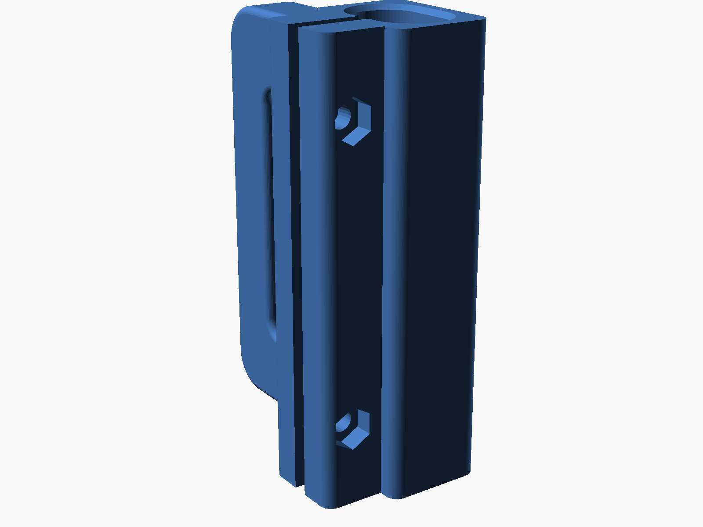

# Baby Gate Handle

A second D-handle for the roll-up mesh baby gate (for the puppy). The collar
slides down over the top of the gate's end bar and clamps onto it with two M3
screws. The loop hooks into the clip on the wall, like the original handle.

- **Split clamp collar:** a 2.5 mm slot runs down the front of the collar, with a
  clamp rib on each side. Two M3 screws go across the slot into nuts sitting in
  hex pockets. Tightening them closes the slot so the collar squeezes the whole
  bar, like a bike seat-post clamp. Nothing pokes the bar, and you can loosen it
  to move the handle.
- **Bore:** 0.3 mm bigger than the bar each way so it slides on easily, with
  chamfered ends; the clamp takes up the gap
- **Loop:** the clip bar is exactly 10.6 × 9.5, the same as the original, with
  the edges rounded inside that size

## Measurements used

| | |
|---|---|
| Gate bar | 15.4 (in the gate's plane) × 10 (front to back), oval |
| Collar height | 69 |
| Loop | 66 outside, 41.15 inside height |
| Top arm | 12.74 measured (12.4 used, so both arms match) |
| Opening width (collar to clip bar) | 18.07 |
| Clip bar | 10.6 wide × 9.5 thick |

Changes from the original:
- The collar is 20.6 × 15.6 outside (2.5 mm walls), plus the clamp ribs on the
  front, which stick out 9.5 mm.
- The loop sits flush with the bottom of the collar instead of 1.5 mm up, so it
  prints on the bed without supports (`loop_lift`).

## Hardware and install

- 2 × M3 machine screws, **14 or 16 mm** long (12 mm only just reaches the nut;
  20 mm sticks out about 4 mm)
- 2 × M3 nuts

1. Press a nut into each hex pocket (on the rib on the mesh side). If they're
   tight, pull them in by threading a screw in from the other side.
2. Slide the collar down over the top of the bar to the height of the wall clip.
3. Put the screws in from the loop side and tighten them a bit at a time,
   alternating, until the handle won't slide. Stop there: the slot doesn't need
   to close all the way.

## Print settings (PETG or PLA)

- Stand it up, the way it is in the STL: collar and loop both on the bed
- **No supports.** The top of the opening is an 18 mm bridge, and the screw
  holes and hex pockets are small and point-up enough to print without them.
- 4 walls, 30–40% infill, so the clip bar and the clamp ribs are solid
- PETG is the better choice: it flexes to clamp without cracking

## If it doesn't fit

All of these are at the top of the `.scad`:

- won't slide onto the bar, or loose on it: `bar_clear`
- clip bar too tight or loose in the wall clip: `clip_w`, `clip_t`
- loop at the wrong height for the clip: `loop_lift` (it's a 69 tall collar
  with a 66 tall loop, so there's 3 mm to play with)
- still slides with the screws tight: lower `bar_clear` (try 0.2), or line the
  bore with a strip of bike inner tube
- nuts won't go in or fall out: `nut_flats`
- screws in a different spot: `screw_zs`
