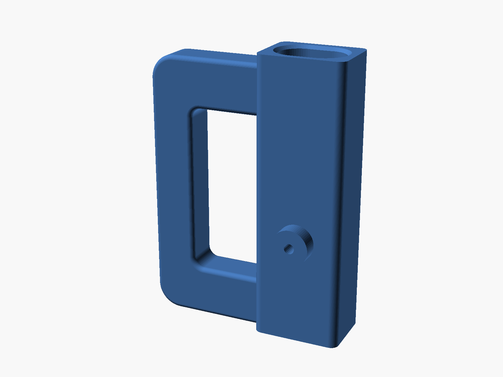
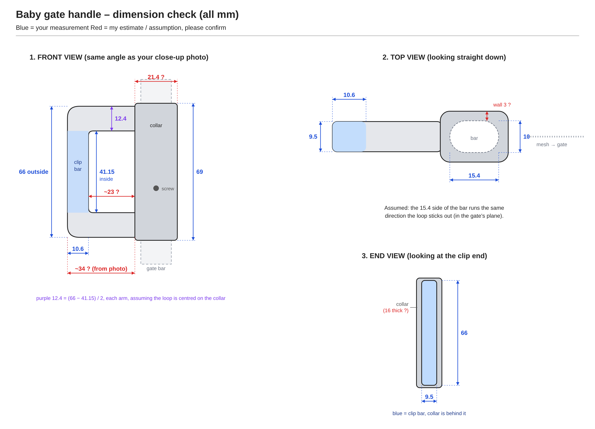
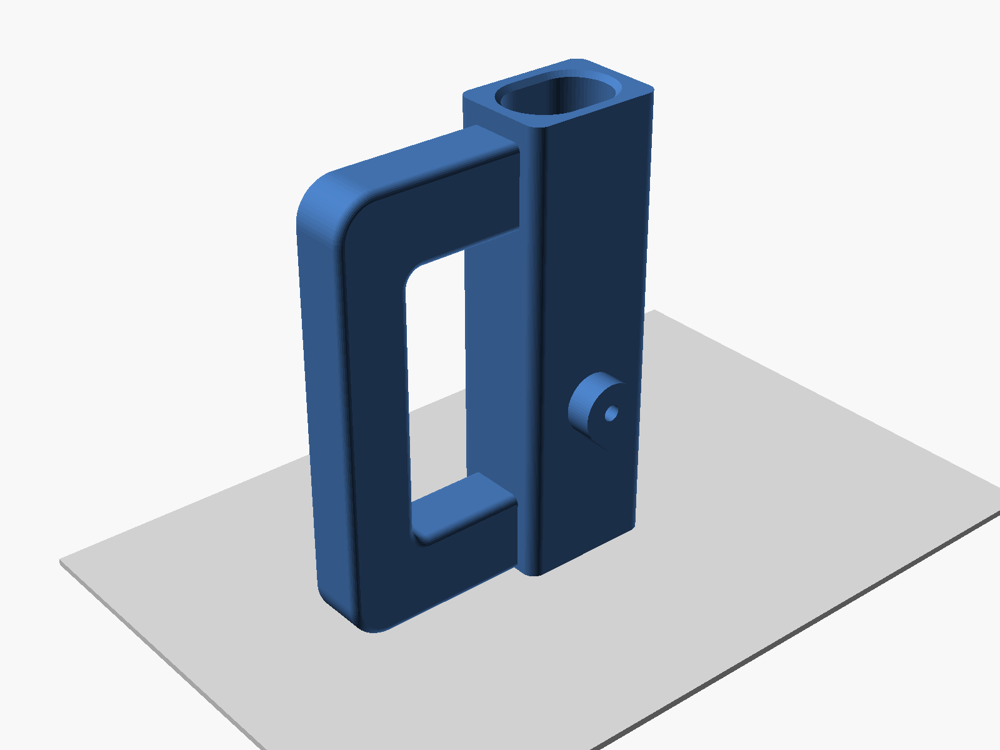

# Baby Gate Handle

A second D-handle for the roll-up mesh baby gate (for the puppy). The collar
slides down over the top of the gate's end bar and a screw holds it in place.
The loop hooks into the clip on the wall, like the original handle.

- **Collar:** wraps the oval bar, with a 0.5 mm slide fit and chamfered ends so
  it starts onto the bar easily
- **Loop:** the clip bar is exactly 10.6 × 9.5, the same as the original, with
  the edges rounded inside that size
- **Screw boss:** on the front, so a self-tapping screw has 6.5 mm of plastic to
  bite into before its tip presses on the bar

## Measurements used

| | |
|---|---|
| Gate bar | 15.4 (in the gate's plane) × 10 (front to back), oval |
| Collar height | 69 |
| Loop | 66 outside, 41.15 inside height |
| Top arm | 12.74 measured (12.4 used, so both arms match) |
| Opening width (collar to clip bar) | 18.07 |
| Clip bar | 10.6 wide × 9.5 thick |

Changes from the original:
- The collar is 21.4 × 16 outside (2.5 mm walls).
- The loop sits flush with the bottom of the collar instead of 1.5 mm up, so it
  prints on the bed without supports (`loop_lift`).

## Screws

`screw_pilot = 2.5` suits a #4 or M3 self-tapping (sheet metal or plastic)
screw, 10–12 mm long. For a #6 or M3.5, set it to 2.8. If the bar has an
existing screw hole, set `screw_z` (the height above the bottom of the collar)
to line up with it.

## Print settings (PETG or PLA)

- Stand it up, the way it is in the STL: collar and loop both on the bed
- **No supports.** The top of the opening is an 18 mm bridge, and the screw
  boss has a 45° underside.
- 4 walls, 30–40% infill, so the clip bar and the screw boss are solid

## If it doesn't fit

All of these are at the top of the `.scad`:

- won't slide onto the bar, or loose on it: `bar_clear`
- clip bar too tight or loose in the wall clip: `clip_w`, `clip_t`
- loop at the wrong height for the clip: `loop_lift` (it's a 69 tall collar
  with a 66 tall loop, so there's 3 mm to play with)
- screw strips or won't go in: `screw_pilot`
