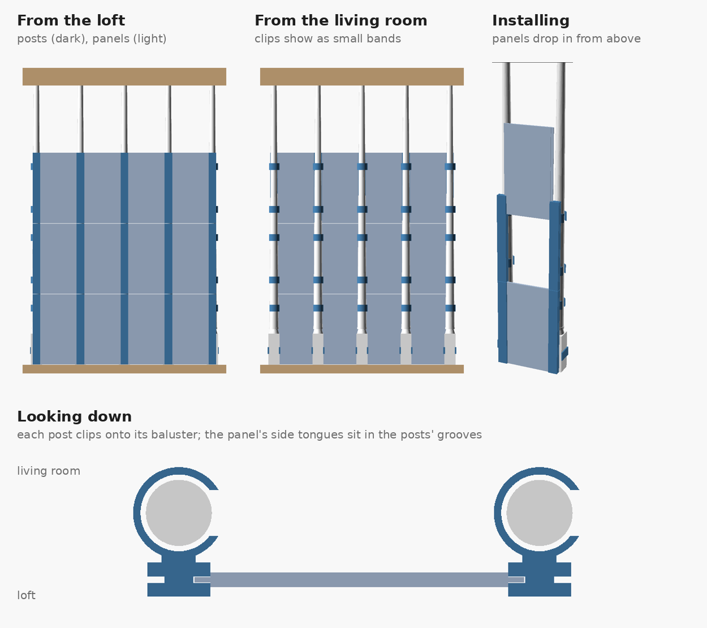
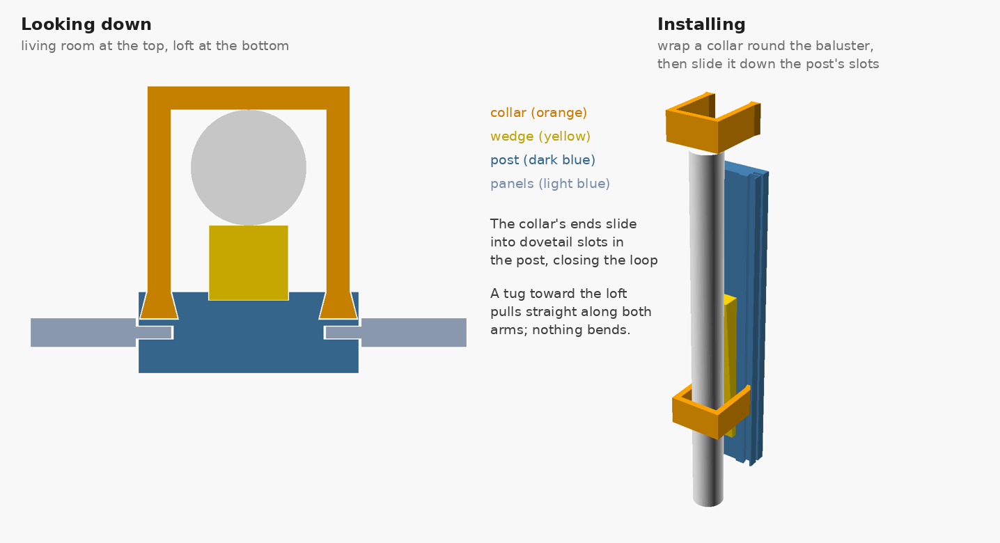
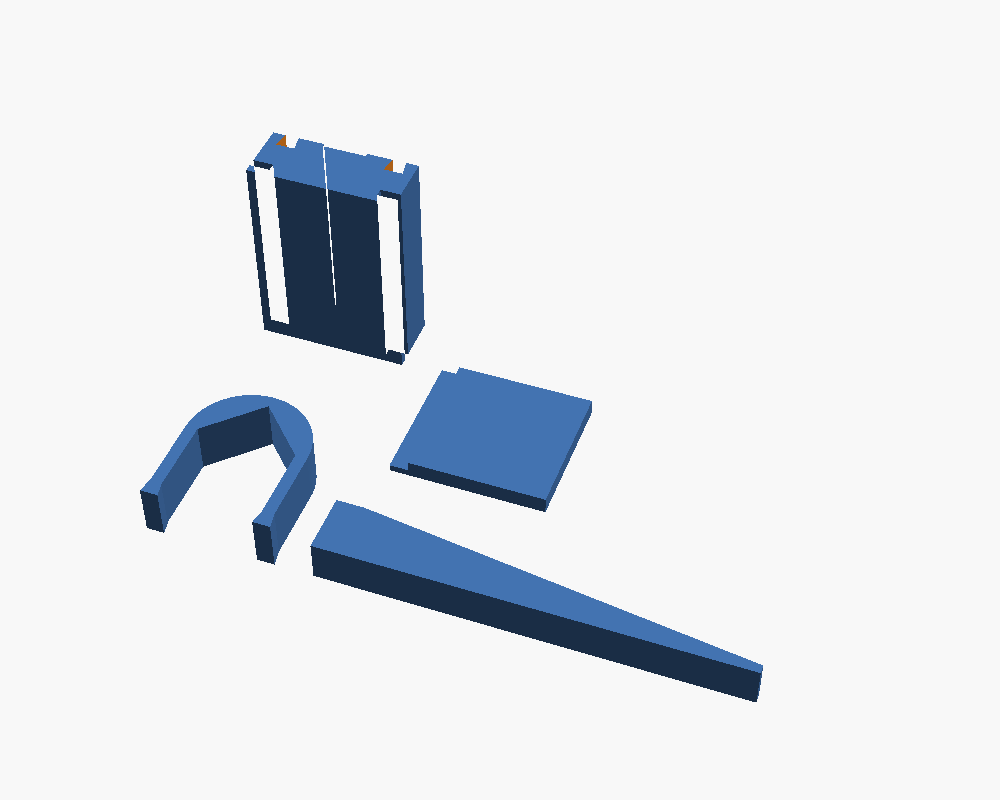

# Loft Cat Wall

A 2 ft tall wall on the loft side of the balusters, so the cats can't squeeze
through the gaps. It's built like a fence:

- a **post** in front of every baluster
- a **U-shaped collar** wraps the back of the baluster and slides down into
  dovetail slots in the post, closing the loop; a tug toward the loft pulls
  straight along both arms instead of bending anything
- a tapered **wedge** pushes the baluster back into the collar's V, so one
  collar size grips anywhere from 16 to 28 mm thick
- **panels** drop down between the posts; their side tongues ride in grooves
  in the posts

Everything is printed, no screws or zip ties, no supports.

## Railing measurements used

| | |
|---|---|
| Baluster center to center | 126.8 mm |
| Square block | 31.9 mm wide, 89.6 mm tall |
| Thinnest round part | 15.9 mm |
| Gaps | 26, one straight run (wall at the left end, wooden post at the right) |
| Bottom rail | sticks out more than 15 mm past the blocks on the loft side |

## Step 1: test kit (print this first)

`stl/test_kit.stl` is one plate with a 60 mm piece of post, a collar, a wedge
and a corner of a panel (about 95 g, roughly an hour).

Check:
1. Wrap the collar around a baluster above the square block and slide its ends
   down into the post's slots. It should slide freely but not rattle.
2. Push the wedge down between the post and the baluster. The collar should
   pull tight. Try it on a thick spot and a thin spot.
3. Slide the panel's tongue into a side groove of the post. It should slide
   without forcing and not flop.

Tell me what's too tight or too loose and I'll adjust the clearances
(`slot_clr`, `groove_clr`) before the full print.

## Print settings (Bambu P2S, PETG)

- 0.2 mm layers, 4 walls, 30% gyroid infill
- Print every part in the orientation it's in in the file (the post stands up,
  the wedge lies on its side)

## Still to do

- Full-height post and panel sections that stack with tongue and groove
- End pieces for the wall (left) and the wooden post (right)
