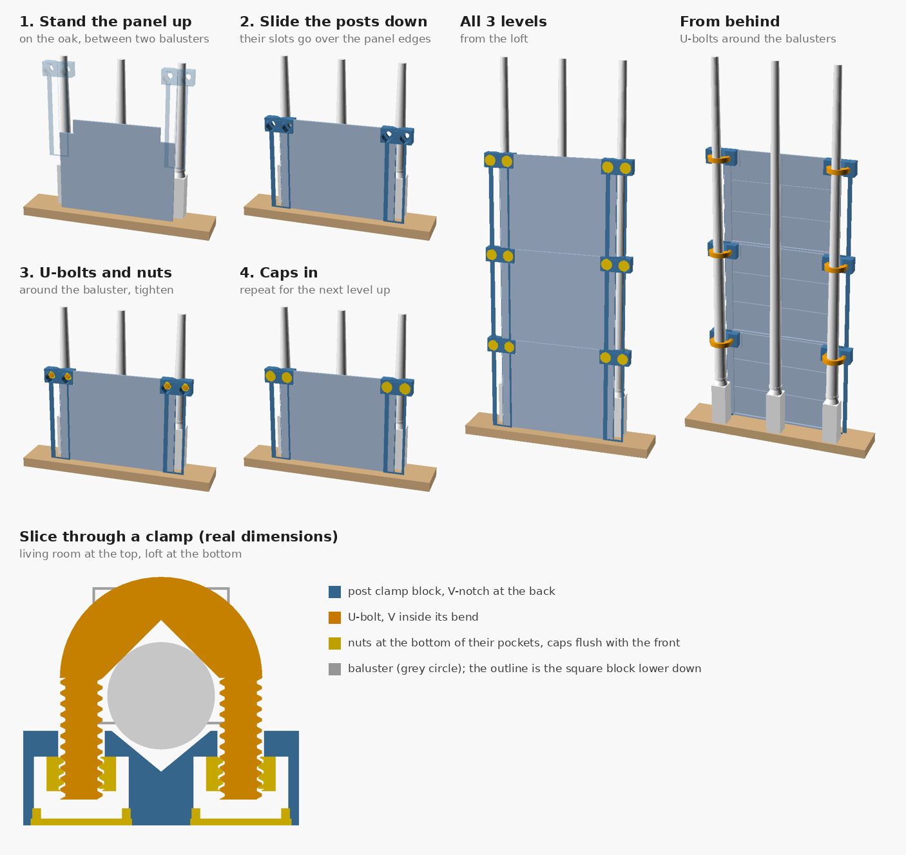

# Loft Cat Wall

A 2 ft tall wall on the loft side of the balusters, so the cats can't squeeze
through the gaps. All renders below come from `loft_cat_wall.scad` itself.

## How it works

- A slim I-beam **post** stands in front of every other baluster (13 posts).
  Each post is 3 sections of 203 mm that stack; a stub on the bottom of each
  section drops into a recess in the top of the one below.
- At the top of each post section is a **clamp block** with a V-notch in its
  back. A printed **U-bolt** goes around the back of the baluster and through
  the block, and two **nuts** pull it tight. The baluster is held between two
  V's, so it can't rock. The clamps are all on the round part of the baluster,
  never the square block.
- The nuts sit at the bottom of round pockets and get covered by snap-in
  **caps**, so the loft side is flat.
- Each **panel** spans two gaps. Its sides sit in the slots between the
  posts' front and back flanges, and its top corners are notched around the
  clamp blocks.

## Putting up one level

1. Stand the panels in place (on the oak for the first level, on the panels
   below after that).
2. Slide the post sections down from above so their slots go over the panel
   edges.
3. Put a U-bolt around the back of each baluster, through the clamp block, and
   tighten both nuts with the wrench.
4. Press in the caps. Repeat for the next level.

## Parts (whole wall, not counting the two ends)

| File | Count | Notes |
|---|---|---|
| `stl/post_0.stl` | 13 | bottom level |
| `stl/post_1.stl` | 13 | middle level |
| `stl/post_2.stl` | 13 | top level |
| `stl/panel.stl` | 36 | 250 × 202 mm, prints flat, face down |
| `stl/ubolt_0.stl` | 13 | arm length for the bottom level |
| `stl/ubolt_1.stl` | 13 | middle level |
| `stl/ubolt_2.stl` | 13 | top level |
| `stl/nut.stl` | 78 | |
| `stl/cap.stl` | 78 | |
| `stl/wrench.stl` | 1 | |

Roughly 6 kg of PETG in total (panels ~3.4, posts ~2, the rest ~0.6).

## Print settings (Bambu P2S, PETG)

- 0.2 mm layers, 4 walls, 30% gyroid infill, no supports
- Keep each part in the orientation it's in in the file: posts print with the
  clamp block on the bed, U-bolts stand on their arm ends (use a brim),
  panels lie face down
- No brim on the panels: at 250 mm they only just fit the bed

## Still needed

- **Baluster thickness at the clamps.** The U-bolt arm lengths assume the
  baluster is 25, 22 and 19 mm thick at 7⅜", 15⅜" and 23⅜" above the oak.
  Measure those and set `clamp_d` before printing the U-bolts.
- **Oak depth.** The front of the wall sits 23.5 mm in front of the square
  blocks; the oak should stick out at least that far.
- End pieces for the wall (left) and the wooden post (right).

`stl/test_kit_v2/` holds the test kit that was printed and checked.
