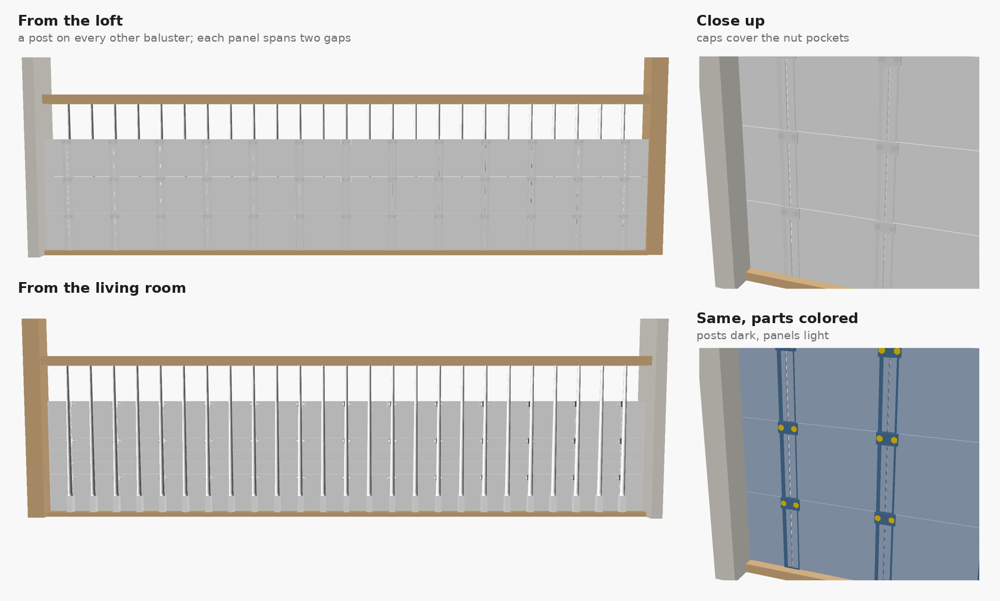
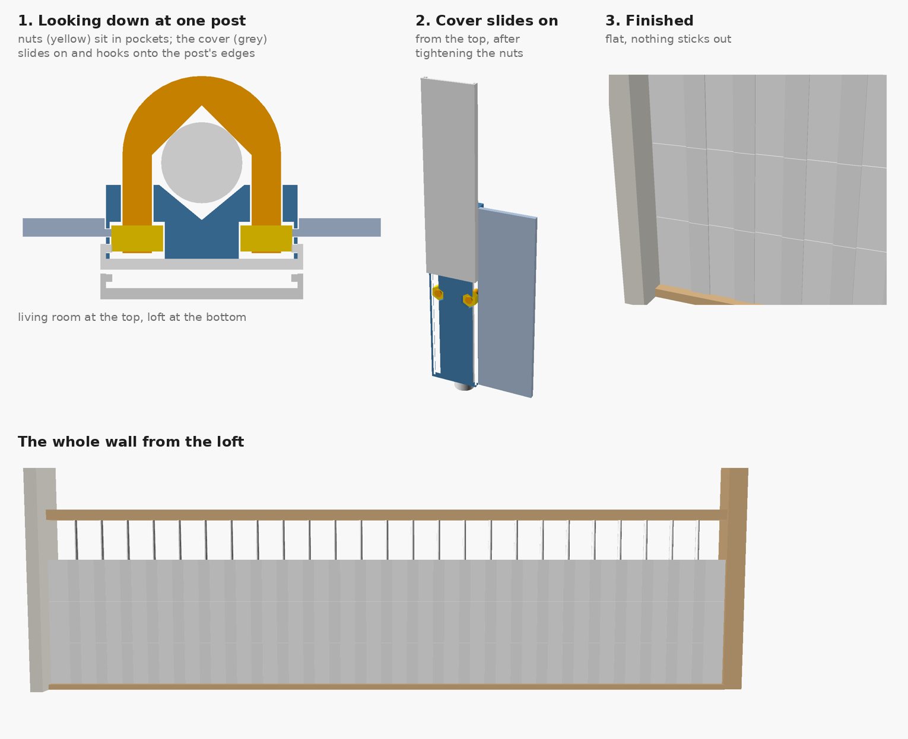
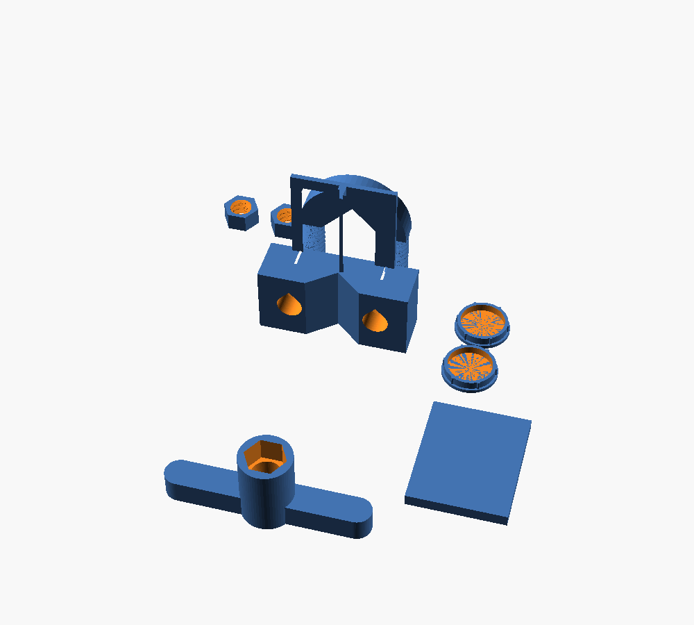
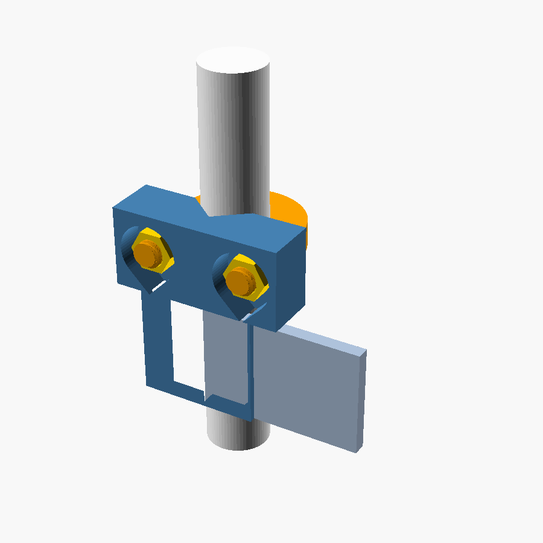

# Loft Cat Wall

A 2 ft tall wall on the loft side of the balusters, so the cats can't squeeze
through the gaps. It's built like a fence:

- a slim **post** on every other baluster (13 posts), each panel spans two gaps
- each post section has a **clamp block** with a V-notch in its back; a printed
  **U-bolt** goes around the back of the baluster and through the block, and
  two **nuts** pull it tight from the loft side. The baluster ends up held
  between two V's, so it can't rock, at any thickness.
- the nuts sit in round pockets and get covered by snap-in **caps**, so the
  loft side is flat with nothing to catch on
- **panels** slide into the slot between each post's front and back flanges

Everything is printed: no screws, no zip ties, no supports.

Estimated filament for the whole wall: about 5½–6 kg (panels ~3, posts ~2.2,
U-bolts/nuts/caps ~0.5).

## Railing measurements used

| | |
|---|---|
| Baluster center to center | 126.8 mm |
| Square block | 31.9 mm wide, 89.6 mm tall |
| Thinnest round part | 15.9 mm |
| Gaps | 26, one straight run (wall at the left end, wooden post at the right) |
| Bottom rail | sticks out more than 15 mm past the blocks on the loft side |

## Test kit (print this first)

`stl/test_kit.stl` is one plate with a short post section, a U-bolt, two nuts,
two caps, a socket wrench and a strip of panel (about 70 g).

Check, on a real baluster above the square block:
1. Thread a nut onto the U-bolt by hand. It should turn smoothly without
   wobbling.
2. Put the U-bolt around the back of the baluster, push its arms through the
   post's block from the back, and tighten both nuts with the wrench. The post
   should end up solid against the baluster, with no rocking.
3. Press a cap into a nut pocket. It should stay put but come out with a
   fingernail.
4. Slide the panel strip into the slot between the post's flanges. It should
   slide without forcing and not flop.

Tell me what's too tight or too loose (`thread_clr`, `panel_slot`, the cap
size) and I'll adjust before the full print.

## Print settings (Bambu P2S, PETG)

- 0.2 mm layers, 4 walls, 30% gyroid infill
- Leave every part in the orientation it's in in the file: the post prints
  with its clamp block down, the U-bolt stands on its arm ends (use a brim)
- No supports

## Still to do

- Full-height post and panel sections, and U-bolts sized for each level
- End pieces for the wall (left) and the wooden post (right)
