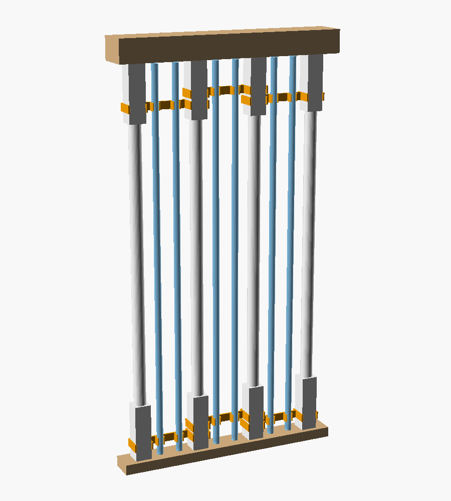
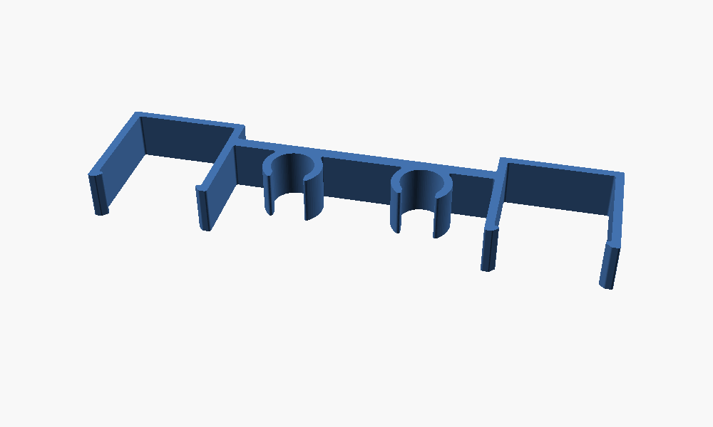

# Baluster Cat Guard

Snap-on clips that hold a vertical rod in the middle of every gap between the
loft balusters. The rods split each gap into narrow slots, so a cat can no longer get its head (or
the rest of itself) through.

## How it works

- Each **clip** spans one gap: it snaps onto the two neighbouring balusters and
  has a third snap in the middle that holds the rod.
- All snaps open toward the loft side, so you install everything from up there:
  push the clip onto the balusters, then press the rod in.
- Use **two clips per gap**: one on the square blocks at the bottom, one on the
  square blocks at the top. The rod stands on the bottom rail.
- Neighbouring gaps share a baluster, so set alternating clips about 20 mm higher
  or lower so they don't collide (or print `gaps_per_clip = 2`).
- Rods: 1/2" (12.7 mm) wood dowels painted white, or clear acrylic rods. Cut each
  one a few mm shorter than the distance from the bottom rail to the handrail.

## Measure first

The defaults are guesses from a photo. Open `baluster_cat_guard.scad` in
OpenSCAD, open the Customizer, and set:

| Parameter | What to measure |
|---|---|
| `baluster_pitch` | Center-to-center distance between two balusters |
| `baluster_size` | Width of the square block where the clip goes |
| `rod_d` | Actual diameter of your rod (dowels vary) |
| `rods_per_gap` | 2 (default) leaves ~20-25 mm openings, 1 leaves ~40 mm |

## Printing

1. Print `part = fit_test` first (4 mm tall, a few minutes). Adjust `clearance`
   until it snaps on firmly and doesn't wobble.
2. Print `part = clip`, flat on the bed, no supports. PETG is best (it flexes
   without cracking). With PLA, raise `round_opening` / lower `square_lip` a bit.
3. 3 walls, 20–30% infill is plenty.
