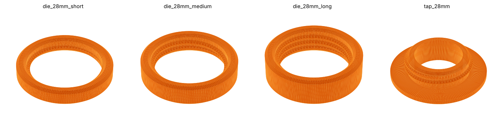
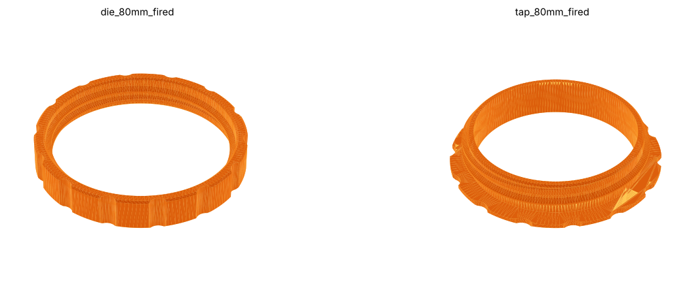
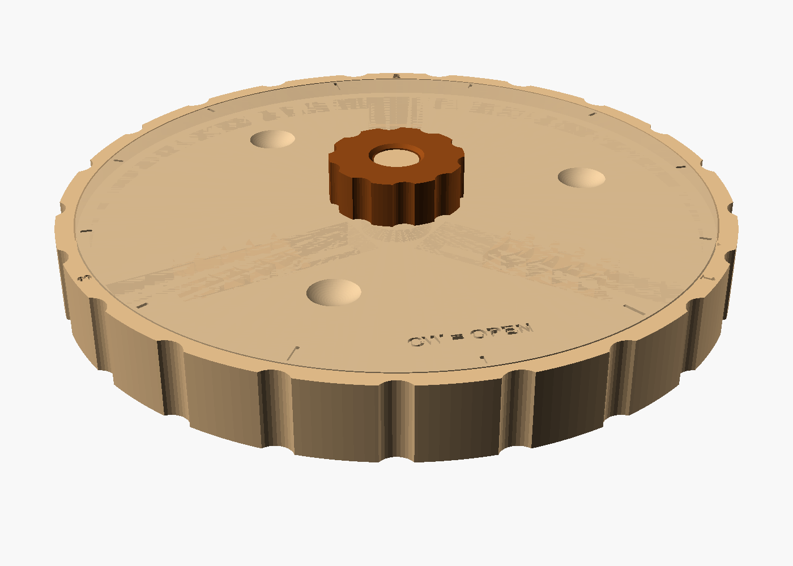
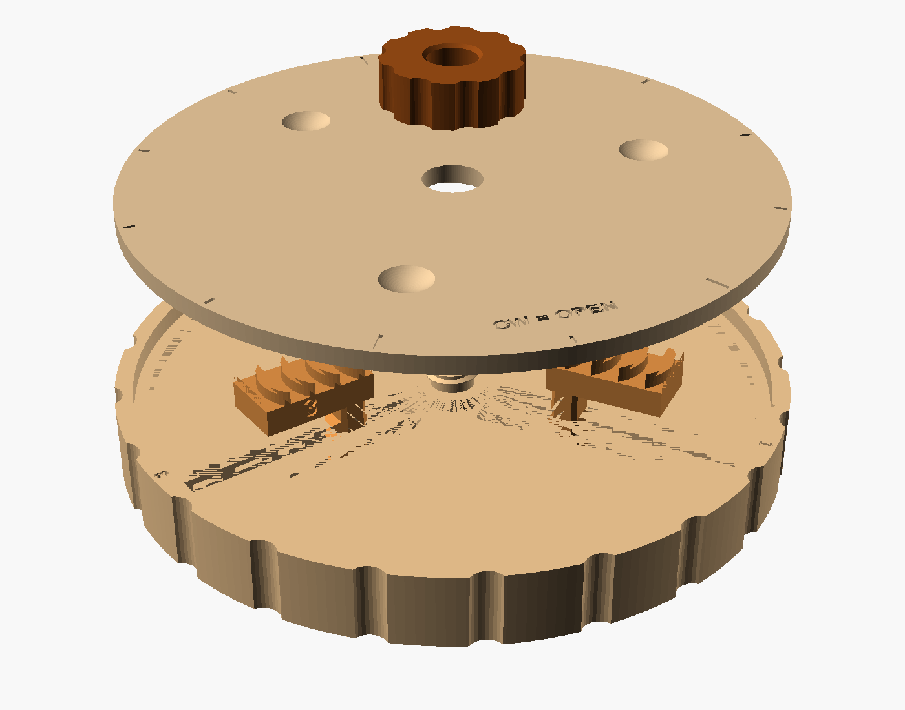
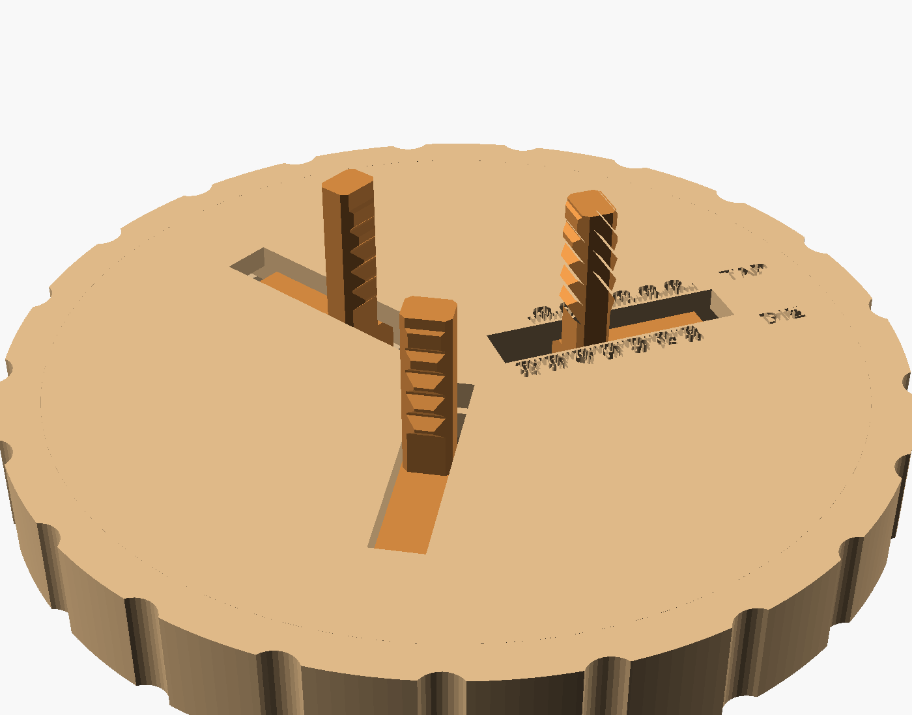

# Clay Threader

A parametric take on the "Clay Threader" pottery tool idea: printed rings
that cut a screw thread into leather-hard clay, so a pot and its lid screw
together after firing. This version adds a size setting from small bottle necks
up to whatever fits a 256 mm bed, an option to compensate for clay shrinkage, and
a matching **tap** for cutting the lid's thread.



- **Die**: a ring with the thread on the inside. Twist it down over the pot's
  neck to cut the outside (male) thread.
- **Tap**: a threaded barrel with a grip flange. Screw it into the lid's
  opening to cut the inside (female) thread.

Both come from the same settings, so a die and a tap made together always
match, with `clay_clearance` of slack between them.

There are two models in this folder:

- `clay_threader.scad`: **fixed** dies and taps, one size per print (below)
- `adjustable_threader.scad`: an **adjustable** tool that dials to any size
  in its range, like a lathe chuck ([jump to it](#adjustable-threader))

## The originals, measured

The three reference STLs (`obj_1/2/3_Gewinde_Ton`) are all dies, and they
differ only in length:

| | Ring | Bore (thread root) | Thread |
|---|---|---|---|
| obj_1 | Ø35 × 6 mm | Ø27.8 | ~0.7 turn total |
| obj_3 | Ø35 × 8 mm | Ø27.8 | ~1.8 turns total |
| obj_2 | Ø35 × 11 mm | Ø27.8 | ~2.7 turns total |

Shared details: single-start, right-hand, 2.7 mm pitch, a ~60° V tooth 1.27 mm
deep with a small flat/rounded tip, teeth that taper in and out at the ends, and
chamfered bore entries. The defaults here reproduce them: `turns` = 0.25, 1 and
2 give the 6, 8 and 11 mm rings (the cross-sections overlay to within a few
tenths of a mm).

## Using it

Open `clay_threader.scad` in OpenSCAD, then **Window → Customizer**. Press F5,
and the console prints the sizes to throw:

```
Throw the NECK at:         90.9 mm outside diameter (wet). Fired: ~80
Throw the LID OPENING at:  86.4 mm inside diameter (wet). Fired: ~76
Die: 101.8 mm across, 17.2 mm tall
```

### Settings

| Group | Setting | What it does |
|---|---|---|
| What to make | `part` | `die`, `tap`, or `both` side by side |
| Size | `neck_d` | Outside diameter of the threaded neck (the die's bore) |
| Clay shrinkage | `account_for_shrinkage` | Checkbox. When ticked, `neck_d` (and pitch, depth, clearance) are the **fired** sizes, and the tool is scaled up to match |
| | `shrinkage_percent` | Your clay body's total wet-to-fired shrinkage. Default 12%. The tool scales by `100 / (100 - shrinkage)` |
| Thread | `pitch` | Tooth spacing. `0` = auto: 2.7 mm at the original size, growing with diameter, capped at 6 mm |
| | `depth` | Tooth height. `0` = auto (0.47 × pitch) |
| | `flank_angle` | V angle. 60° is standard; blunter is kinder to soft clay |
| | `turns` | Full-depth turns, i.e. how far the lid turns to close |
| | `lead_in_turns` | Ramp at each end so the cut starts shallow |
| | `starts` | 2–3 interleaved threads for a fast-closing lid. Use fewer `turns` with these, since each turn rises `starts × pitch` |
| | `left_hand` | Reverse the thread |
| Fit | `clay_clearance` | Radial gap between the pot's and the lid's threads (fired size). Raise it if glaze will go on the threads |
| Tool body | `wall` | Ring wall. `0` = auto (3.6 mm at the original size, 6% of the diameter on big rings) |
| | `grips` | Finger scallops. `-1` = auto (on once the wall is 5 mm+), `0` = off |
| | `tap_flange`, `tap_flange_t` | Size of the tap's grip flange |
| Printer | `bed_size` | The model refuses to render a part bigger than this (default 256) |

### Shrinkage

Clay shrinks roughly 10–15% from wet to final firing. If you're aiming for a
lid that fits a commercial part, or you want a specific finished size, tick
`account_for_shrinkage` and enter your clay's number. The whole thread (diameter,
pitch, depth and clearance) is scaled up, so it shrinks back to the size you
typed. To find your number, mark a 100 mm line on a wet slab, fire it, and
measure: `shrinkage_percent = 100 - fired length`.

The pot and the lid shrink together, so they still fit each other with the box
unticked. Leave it off if you only care about the two parts matching.

### Size limit

With the auto wall, the biggest die that fits a 256 mm bed has a bore of about
228 mm, or about a 200 mm fired neck at 12% shrinkage. Push past that and
OpenSCAD stops with an error saying how big the part came out. Big rings take
about 30 s to render, and a big multi-start tap takes a couple of minutes.

## Pottery workflow

1. Throw the neck a little taller than the die, at the "throw the NECK at"
   diameter. Throw the lid's flange or opening at the "LID OPENING" diameter.
2. Let both firm up to **leather hard**. Too soft and the thread smears, too dry
   and it crumbles.
3. Dust the tool with cornstarch, or wipe it with a little oil, so it releases.
4. Die: start it square on the neck (the chamfer helps) and twist clockwise
   with light downward pressure. Back off half a turn now and then to clear
   the clay, like cutting metal threads. Unscrew it to remove.
5. Tap: same idea, screwed into the lid opening. Support the outside of the lid
   with your other hand.
6. Test-fit the lid on the pot before bisque, and clean up crumbs with a soft
   brush. Keep glaze off the threads, or raise `clay_clearance`.

## Print settings

- Print flat as exported. Die either way up; tap with the flange on the bed
- No supports. The tooth's lower flank is a 30° overhang only ~1–3 mm long
  and bridges fine. If it droops on your printer, raise `flank_angle` to 80–90
- PLA or PETG, 3+ walls, 0.2 mm layers or finer for pitches under 3 mm

## Files

- `clay_threader.scad`: the model
- `stl/die_28mm_short|medium|long.stl`: copies of the three originals (`turns` 0.25 / 1 / 2)
- `stl/tap_28mm.stl`: matching tap for those dies
- `stl/die_50mm.stl`, `stl/tap_50mm.stl`: 50 mm neck, auto pitch (4.85 mm), shrinkage off. Throw the neck at 50 mm OD and the lid opening at 46.4 mm ID



*An 80 mm (fired) jar set with 12% shrinkage on and auto pitch: the die is
102 mm across, with finger scallops.*

## Not tested yet

These have only been checked in software (a watertight mesh, and an overlay
against the original's cross-section). They haven't been printed or tried on
clay yet. Things to check on the first real run: whether 0.5 mm clearance is
enough after glaze, and whether big thin taps flex while cutting (raise `wall`
if they do).

---

# Adjustable threader

One tool that cuts threads on a whole range of pot sizes. Find a size that
works once, note the number, and dial back to it any time.



It works like a 3-jaw lathe chuck:



- **Body**: the bottom disc, with 3 radial channels and a grip rim
- **3 jaws**: one slides in each channel. Each jaw has a **leg** that hangs
  below the body with a comb of thread teeth on **both** faces:
  - inner face = **die**: cuts the outside thread on a pot's neck
  - outer face = **tap**: cuts the inside thread of a lid
- **Scroll**: the top plate. A spiral ridge on its underside runs in grooves on
  the jaws, so turning it moves all three jaws in or out together, always
  centred. It turns clockwise (from above) to open
- **Knob**: screws onto the centre post. Tighten it to clamp the scroll and
  lock the setting

The teeth are straight combs, not full circles, so the same jaws cut the same
thread at any diameter. Each jaw's teeth sit ⅓ of a pitch higher than the one
before, so all three follow one helix. **The jaws are numbered 1–3 and must
go in the matching numbered slot** (the numbers are on the jaw's side and on
the rim).

## Sizes

| Tool | Diameter | Die cuts necks | Tap cuts lids for necks |
|---|---|---|---|
| `small` | 150 mm | 18–83 mm | 31–97 mm |
| `large` | 250 mm | 60–183 mm | 74–197 mm |

These are with the default 4 mm pitch and no shrinkage. The tap range starts
higher because all three legs have to fit inside the lid opening. For the
smallest bottle lids, use a fixed tap from `clay_threader.scad`. `custom`
lets you choose any tool diameter and smallest neck.

Each set of jaws cuts one thread pitch. For a different pitch, print another
set of jaws (`pitch` setting); the body, scroll and knob stay the same.

## Setting the size



Flip the tool over. Along slot 1 there are two rulers, both labelled in
**neck diameter**:

- **DIE** side: read where the leg's **inner** face lines up
- **TAP** side: read where the leg's **outer** face lines up

For a matching pot and lid, set the die to the neck size (say 50) and cut the
neck. Then set the tap to the **same number** (50) and cut the lid. The tap
setting already includes the `clay_clearance` gap. Throw the lid opening a little
smaller than the neck; the console prints the exact amount (about 2 mm less at
the default settings).

For fine adjustments, use the dial on the scroll: **one tick = 1 mm of
diameter** (a long tick every 5). The index notch is on the rim beside slot 1.

To adjust: loosen the knob half a turn, hold the rim, turn the scroll by its
finger dimples, then tighten the knob again.

With `account_for_shrinkage` on, the rulers are labelled in **fired** sizes and
the jaws are scaled up to match, so you can dial the finished size you want.

## Cutting

1. Set the size and lock the knob.
2. Hold the tool by its **outer rim**, not the scroll, and set the legs over the
   neck (die) or inside the lid opening (tap), level.
3. Turn clockwise with light pressure. The short, shallow teeth at the bottom of
   each leg start the cut, then the thread pulls the tool down. Back off half
   a turn now and then to clear crumbs.
4. Each pass cuts up to the length of the legs (25 mm at a 4 mm pitch; more
   `comb_teeth` makes them longer).
5. Unscrew it to remove, then rinse. Everything comes apart for cleaning:
   take off the knob, lift off the scroll, and pull out the jaws.

## Printing

| Part | How it prints | Notes |
|---|---|---|
| `body` | rim down | Rulers are engraved in the first layer; the centre post is threaded |
| `scroll` | top face down, ridge up | |
| `jaws` | grooved top on the bed, legs pointing up | All 3, numbered |
| `knob` | flat | |

- No supports anywhere. The leg teeth default to a 90° V (45° flanks) so they
  print upright cleanly. `flank_angle = 60` matches the fixed dies, but the
  teeth will droop a little
- PLA or PETG. 0.2 mm layers; 0.12–0.16 mm makes the ruler text crisper
- `fit` (default 0.35 mm) is the sliding clearance. If the jaws bind in the
  channels or the spiral, raise it to 0.4–0.45 and reprint the jaws

## Checked so far

- Every part renders as a single closed solid
- The jaws were checked for collisions against the body and the scroll at
  5 settings across the small tool's range, with all three jaws. None hit
- **Not printed yet.** Things to check first: how the jaws slide, whether the
  spiral turns smoothly over the full range, and whether the knob locks it
  firmly enough while cutting
