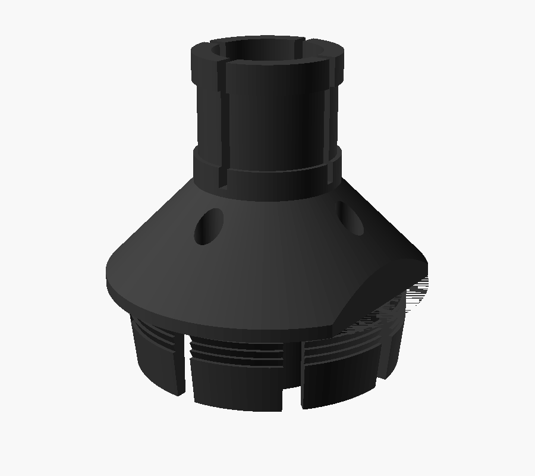
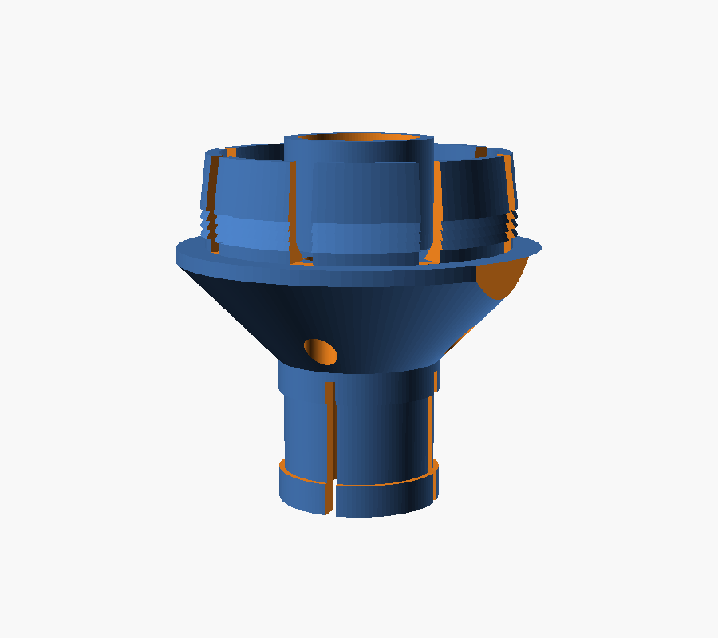

# Condensate Pump Tube Grommet

Holds the water softener's drain tube in the inlet hole of the basement
condensate pump (a Little Giant VCMA-style pump with a sheet-metal lid). The
tube kept popping out of the bare hole, probably kicked out by the softener
flushing at line pressure, and dumping water on the floor.

How it works:

- a **flange** sits on top of the lid, so the grommet can't fall in. It's
  shaved flat on one side, because the pump's motor housing sits right at the
  edge of the hole
- **8 snap fingers** go down through the hole. Each has a row of 4 ratchet
  teeth, and whichever tooth clears the underside of the lid catches it, so it
  latches on any lid from about 1 to 4.3 mm thick (the real thickness was too
  hard to measure)
- a slotted **collar** on top takes a mini hose clamp (or a zip tie) that
  squeezes it onto the tube. The bore is a slip fit, so the clamp does all the
  gripping
- a short **sleeve** hangs below the lid and points the tube straight down
- 4 **vent holes** keep the tank from being sealed

## Measurements used

| | |
|---|---|
| Lid hole | 34.6 mm |
| Drain tube | 13 mm OD, 10 mm ID |
| Lid thickness | unknown, covered by the ratchet teeth (1–4.3 mm) |
| Motor housing | right at the hole's edge (`motor_gap = 0`) |

## Print settings (PETG)

- Leave it the way it is in the file: collar end on the bed, fingers up
- **No supports.** The top of the flange is a 45° cone so it builds without any
- At least 4 walls, so the 1.6 mm fingers print solid
- TPU (95A) also works and goes in easier, but it holds by friction and a
  soft ridge, so a hard yank pulls it out sooner than PETG

## Install

1. Pull the tube out of the pump and push its end through the grommet, collar
   end first.
2. Turn the flat side toward the motor and push the grommet straight down into
   the hole until it stops. You should feel it click over the teeth. Lift it:
   it should only rise about 1 mm before it catches.
3. Slide the tube to the depth you want.
4. Put a **stainless mini worm-drive hose clamp** in the collar's groove: 8 mm
   (5/16") band, with a range that includes 17 mm (e.g. 11–20 mm or 13–19 mm).
   Tighten until the tube won't slide when you tug it, then stop.
5. Zip-tie the tube to something solid about a foot back, so that's what takes
   the jolt when the softener flushes.

Keep the sleeve clear of the float (`sleeve_len`; 0 removes it).

## History

- **v1–v2** were sized from a photo (28 mm hole, 9.5 mm tube) and didn't fit.
  v2's thin fingers also broke off while removing supports.
- **v3** used the real measurements and printed without supports, but its
  flange hit the motor housing.
- **v4/v5** added the flat on the motor side (v5 also widened the groove for a
  hose clamp). They fit, but only went about 2/3 of the way in: the 4 wide
  fingers were too stiff, and the single catch may sit too high for the lid.
- **v6** (this one) has 8 narrower fingers with ratchet teeth. Printed in PETG
  and installed: it pushes all the way in, latches, and holds the tube.

## If it doesn't fit

All of these are at the top of the `.scad`:

- won't go into the hole, or loose in it: `hole_d`
- too hard to push in: lower `tooth_lip`, or `finger_t`
- tube won't slide through, or too sloppy: `tube_clear`
- fingers or sleeve hit something under the lid: `sleeve_len`, `ramp_h`

