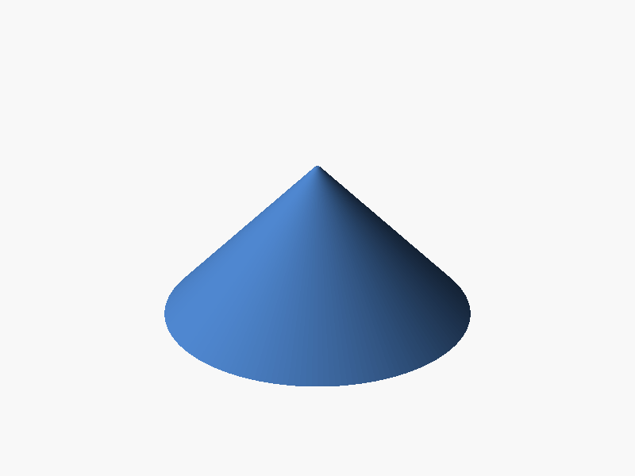

# Cone

A plain cone from Mom's sketch: **5" across the base**, with **3 1/2"** written
along the sloped side.

## Which 3 1/2"?

The 3 1/2" is written next to the sloped side, so `cone.scad` treats it as the
**slant length** (base edge to tip). That makes the cone squat: about
**2.45" (62 mm) tall**.

If it was meant to be the **straight-up height**, set `side_is_slant = false`
and the cone is 3.5" (89 mm) tall.

## STLs

| File | What it is |
|---|---|
| `stl/cone.stl` | Solid, 3 1/2" slant, 2.45" tall (default) |
| `stl/cone_hollow.stl` | Same size, hollow with 2 mm walls and an open bottom |
| `stl/cone_tall_3.5in.stl` | Solid, 3 1/2" straight-up height |

## Options in `cone.scad`

- `base_diameter_in`, `side_in`: size in inches
- `side_is_slant`: whether `side_in` is the slope or the height
- `wall_mm`: 0 = solid, otherwise a hollow cone with this wall thickness
- `tip_flat_mm`: a tiny flat on the tip (default 2 mm) so it prints cleanly

## Printing

Base down on the bed, no supports needed. The solid version uses a lot of
plastic at 5" wide, so keep infill low (10–15%) or print the hollow one.
