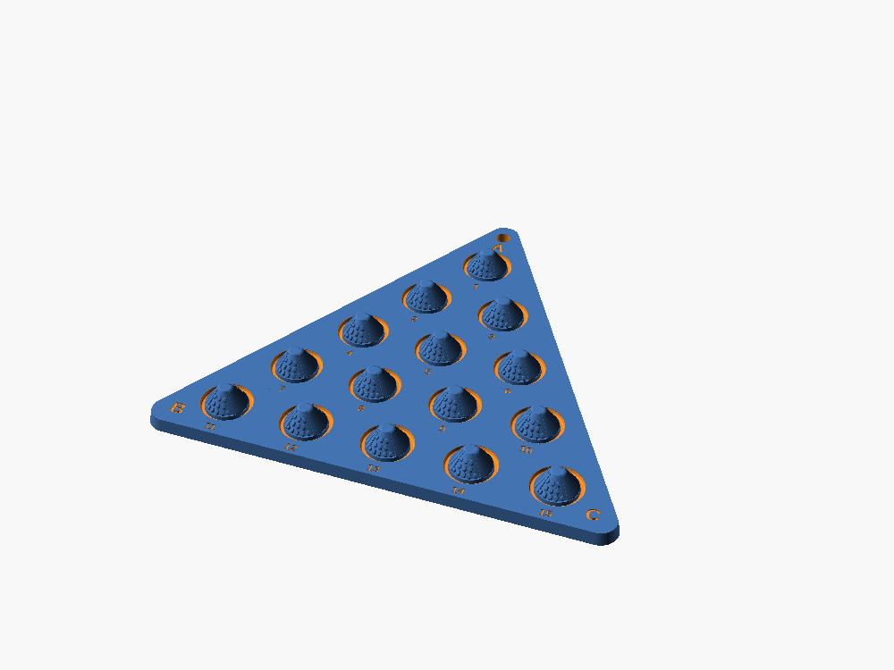
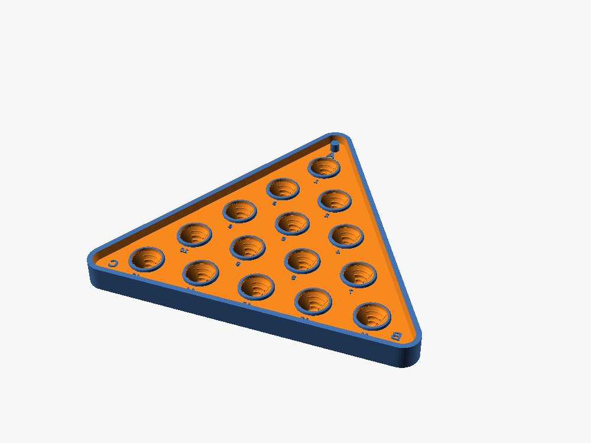
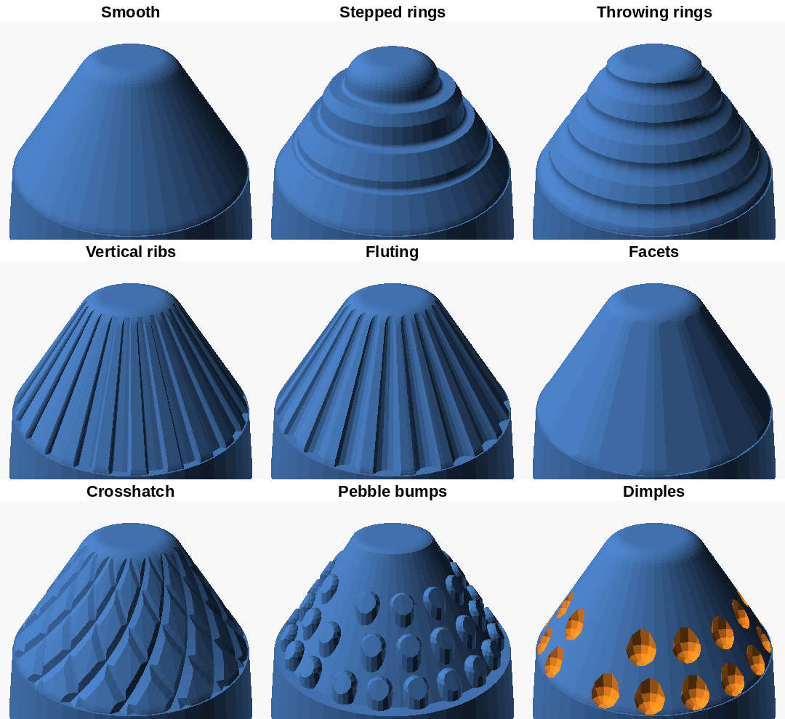
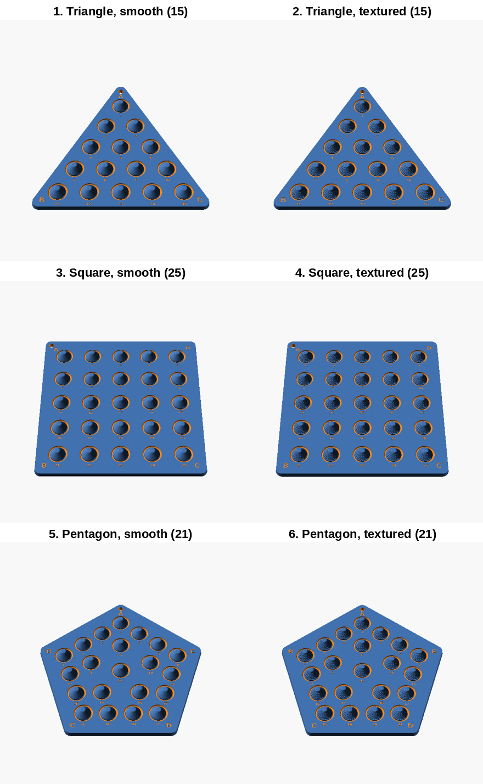
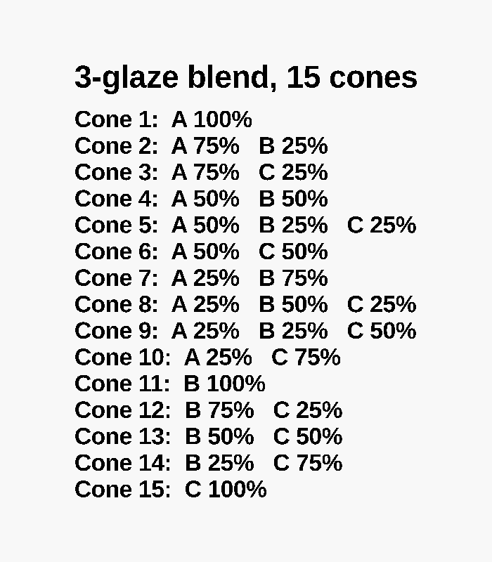
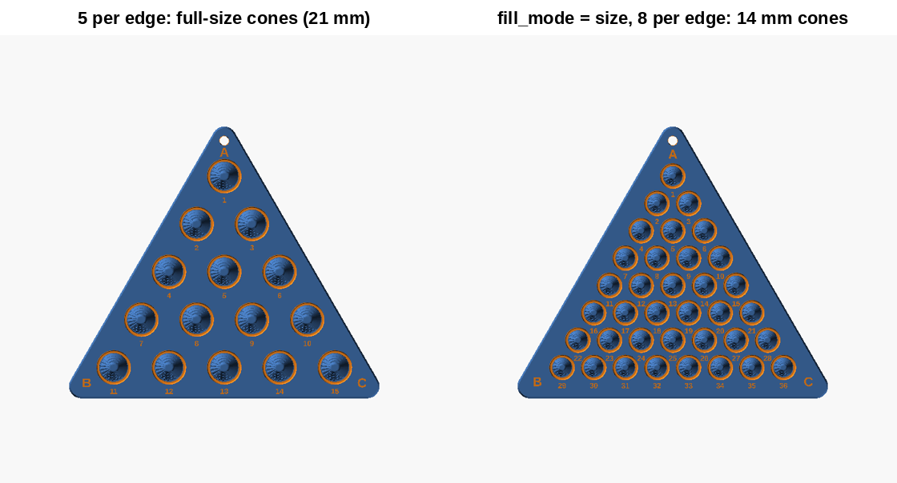
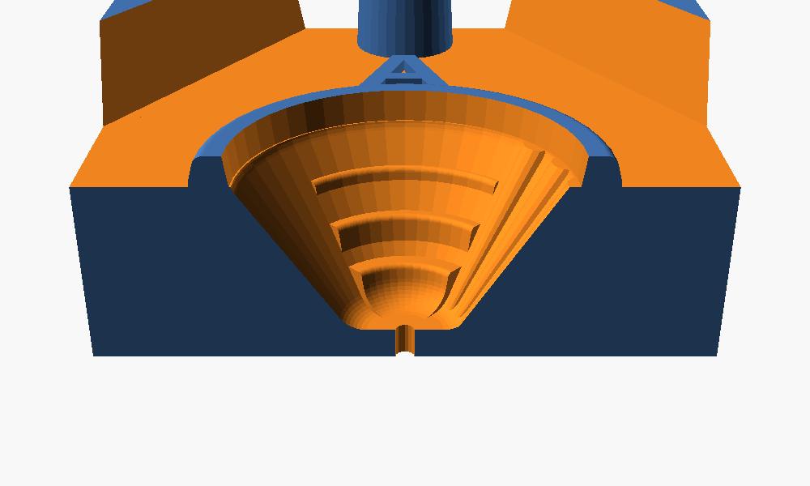

# Glaze Blend Press Mold

A press mold for glaze test tiles. You press clay into the tray, scrape it flat
across the wall tops and turn it out, and the tile comes out covered in raised
cones: one cone for every blend of the glazes at the corners. Each cone is split
into wedges of different surface textures, the same set on every cone, so one
firing shows how every blend breaks, pools and runs on every texture.

It started from Old Forge Creations' "Triaxial Glaze Test – Slab Press Stamp" on
MakerWorld, which stamps stepped **wells** into a slab. My mom wanted the clay
**raised** instead, so this is the inverse: a tray you press clay into. All of the
geometry here is new; only the idea came from that stamp.

How it works:

- the tile is a regular polygon with one glaze at each **corner**: 3 sides is a
  classic triaxial blend, 4 a quadraxial, 5 a pentagon, up to 12. Cones sit at
  every corner, along every edge and in rings towards the middle
- each **cone** is split into texture wedges (stepped rings, fluting, pebble bumps
  and smooth by default, nine to choose from). Every texture is drafted so the
  clay lets go of it
- a **groove** around each cone catches pooling glaze
- **corner letters** and **cone numbers** are cut into the clay, so every tile
  comes out labelled. They're mirrored in the mold so they read right on the tile
- a tapered **post** makes a hanging hole in one corner. It's sized for the hole
  you want *after* firing; the clay's shrinkage is added on
- a 1.2 mm **vent** runs from every cone tip out through the bottom. Push a pin up
  through it to pop a stuck cone, and it lets air out while you press
- the file works out each cone's **blend recipe** (`show = "recipes"`)

## Versions in `stl/`

All 240 mm wide, which fits a 256 mm bed (Bambu P2S, P1, X1).

| File | Glazes | Cones | Size (mm) |
|---|---|---|---|
| `triangle_15_cones_smooth.stl` | 3 | 15 | 240 × 211 × 18.5 |
| `triangle_15_cones_textured.stl` | 3 | 15 | 240 × 211 × 18.5 |
| `square_25_cones_smooth.stl` | 4 | 25 | 240 × 240 × 18.5 |
| `square_25_cones_textured.stl` | 4 | 25 | 240 × 240 × 18.5 |
| `pentagon_21_cones_smooth.stl` | 5 | 21 | 240 × 230 × 18.5 |
| `pentagon_21_cones_textured.stl` | 5 | 21 | 240 × 230 × 18.5 |

The square takes about twice the plastic of the triangle (683 cm³ of model
against 345), so check the slicer's estimate first.

## Print settings (PLA)

- Leave it the way it is in the file: tray floor on the bed, cavities up
- **No supports.** Every surface in the cavities faces up or is drafted
- 0.12–0.16 mm layers. Layer lines print straight into the clay
- 4 walls and 6 top layers, so the floor doesn't dimple when you press hard
- 20–25% gyroid infill is plenty; it sits flat on the table, so pressing only
  squashes it
- PETG works too. TPU doesn't help at this thickness: it's too thick to flex

## Use

1. Dust the mold with cornstarch, every time.
2. Press clay into the cones first, then fill the tray.
3. Scrape it flat across the wall tops with a rib or wire. The walls set a 6.5 mm
   slab, and the scrape cuts the clay level with the hanging-hole post.
4. Turn it out onto a board. If a cone sticks, push a pin up through its vent.
5. Smooth the edge of the hanging hole, dry it slowly under plastic, and fire.

Corners are 100% of one glaze and the cones between are blends. On the
15-cone triangle they go in 25% steps: cone 1 is 100% A, cone 2 is 75% A + 25% B,
cone 5 is 50% A + 25% B + 25% C, and so on. For any other shape, set
`show = "recipes"` for the full card (the recipes are also printed in the
console).

## Customizing

Everything is a Customizer setting with a plain name (Window → Customizer in
OpenSCAD, or MakerWorld's Parametric Model Maker). The useful ones:

- `sides`: number of glazes. `cones_per_edge`: cones along each edge
- `target_width`: overall mold width (240 by default; 0 sizes it from
  `min_cone_spacing` instead)
- `fill_mode`: what to do with the room. `spacing` keeps your cones and spreads
  them out, `cones` fits as many as it can, `size` keeps `cones_per_edge` and
  shrinks the cones just enough to fit (never past `cone_base_radius`)
- `texture_1` … `texture_6`: pick up to six from smooth, stepped rings, throwing
  rings, vertical ribs, fluting, facets, crosshatch, pebble bumps and dimples
- `cone_height`, `cone_base_radius`, `cone_top_radius`, `slab_thickness`,
  `edge_margin`, `hanging_hole_corner`, `hanging_hole_diameter`,
  `clay_shrinkage_percent`
- `show`: `mold`, `tile` (the clay you'll get), `recipes`, `cone` or `cut`

The file checks itself. If something won't fit (too many cones, a mold bigger
than `printer_bed_size`, a hole that won't fit its corner) it stops and says what
to change. If a texture setting is too strong for a gentle cone and would hook
into the clay, it eases it to the safe limit and prints a NOTE instead.

Clay shrinks about 10–12% from wet to fired. Check the tile will fit your kiln
shelf.

## History

- **v1** was my mom's first design (made with Claude): smooth pointed 14 mm cones in a solid
  25 mm block, 247 mm wide. It worked in principle but had nowhere for air to
  go, sharp tips that would tear off, no labels and a lot of plastic.
- **v2** added the vents, rounded and stepped cones, letters and numbers, and
  the hanging hole, at 198 mm.
- **v3** split each cone into texture wedges. Ribs and crosshatch hooked into the
  clay at first; both were reshaped until nothing faced back toward the tile.
- **v4** made it any polygon with any number of glazes, plus the recipe card.
- **v5** added `target_width` (240 mm for the P2S) and the fill modes.
- **v6** fixed shards in MakerWorld's newer OpenSCAD (texture wedges that only
  touched on a shared plane) and every other place surfaces only just touched.
- **v7** fixed the error when changing the cone size, made gentle cones release
  properly, and added `fill_mode = "size"`.
- **v8** (this one) renamed every setting to something readable, and wraps each
  cone in `render()` so desktop OpenSCAD's preview (F5) shows the mold instead
  of nothing. The STLs are rendered from it and checked: watertight, no bad
  edges, every cone vented, and no surface that would hook the clay.

## If it doesn't work

- clay sticks in the cones: more cornstarch, and push it out through the vents.
  Shallower `cone_height` or fewer `step_count` also help
- floor dents when you press: more top layers or infill
- the tile cracks at the cone bases while drying: dry it slower, or lower
  `cone_height` so the cones aren't as thick
- hanging hole too small after firing: set `clay_shrinkage_percent` to your
  clay's real number
- want the edge tighter: lower `edge_margin`. The hanging hole and the
  triangle's bottom-row numbers set a minimum, so turn those off to go further

