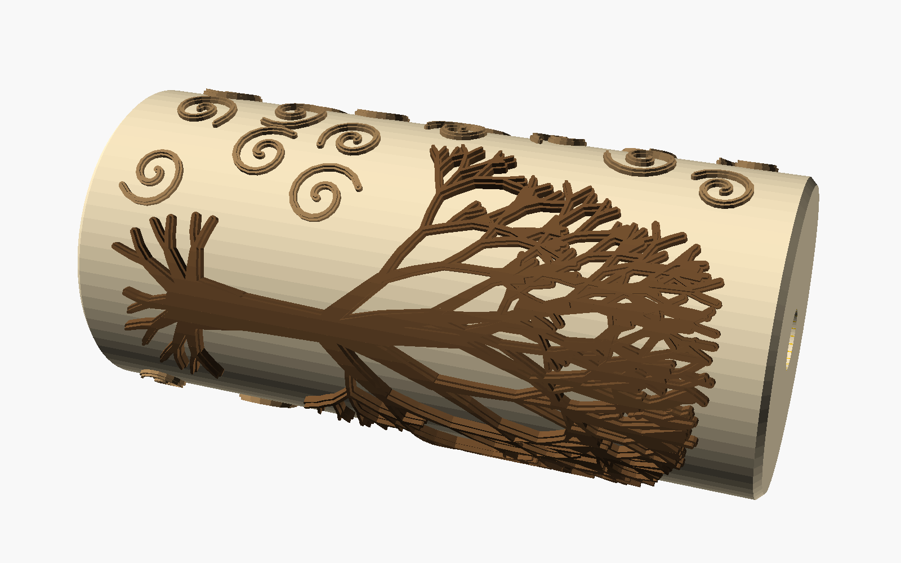
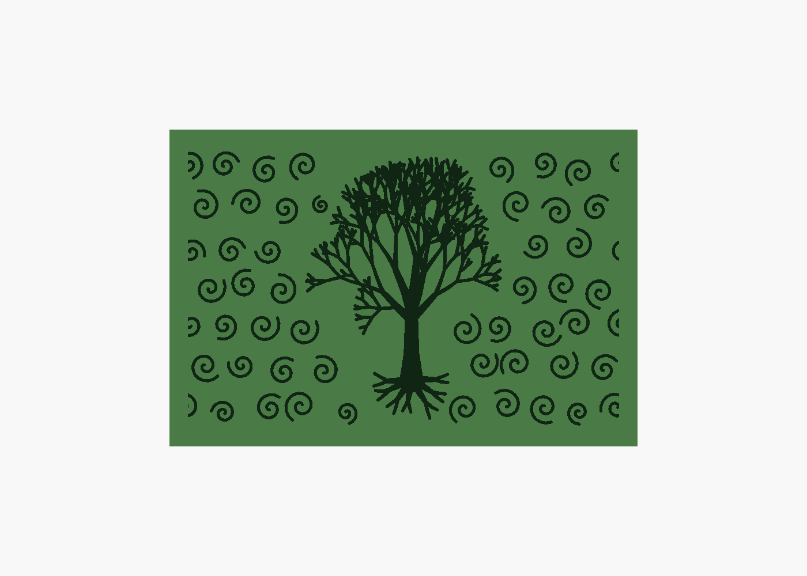
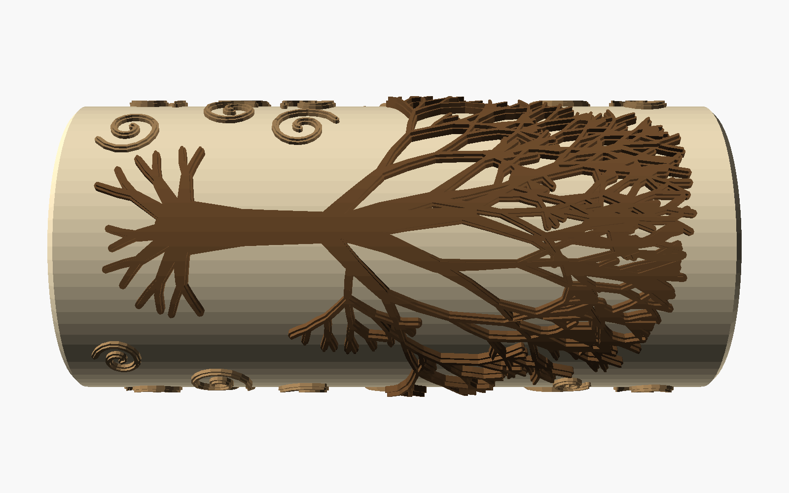

# Tree Pottery Roller

A texture roller for clay. Roll it once across a slab and it presses in a bare,
branching tree with spreading roots, on a background of little swirls: the same
look as the green tree coaster it was made from. Cut a circle around the tree
for a coaster, spoon rest or dish.

The tree and swirls stand up from the roller as ridges, so in the clay they come
out as **grooves**. That's where a glaze like the green one pools dark, so the
tree shows up dark on a lighter background. This is what one roll looks like in
the clay:

- the tree runs along the roller's length, so **one turn = one tree** (141 mm
  of clay per turn on the default 45 mm roller)
- it's mirrored on the roller, so the tree in the clay faces the way the
  preview shows
- the swirls wrap all the way round and meet without a seam. Near the tree they
  shrink to fit between the branches, or are left out, so nothing gets cut into
  odd little dashes
- the ridges are stepped (narrower on top) so the clay lets go cleanly, and the
  thinnest twigs only reach the first step, so they press shallower, like a
  carved line
- an 8.6 mm hole through the middle takes an 8 mm or 5/16" dowel as a handle

The tree is drawn by the file from a number (`tree_seed`), not traced from the
photo, so it's the same style of tree rather than an exact copy. Change the seed
for a different tree.

## Files in `stl/`

| File | What |
|---|---|
| `tree_roller.stl` | Tree and swirls. 46.6 mm across the ridges × 100 mm long |
| `tree_roller_no_swirls.stl` | Tree only, plain background |

## Print settings (PLA)

- Stand it **on end**, axis straight up. No supports: the ridges only stick out
  1.6 mm, and their undersides are short enough to bridge
- 0.12–0.16 mm layers, so the curves on the ridges print smooth
- 3 walls, 15% infill is plenty
- PETG works too

## Use

1. Dust the roller (or the clay) with cornstarch.
2. Roll out a slab first, about 6 mm, then roll the tree roller across it once
   with even, firm pressure. Don't go back over it; a second pass doubles the
   lines.
3. Cut the shape you want around the tree.
4. Glaze with a breaking glaze (one that goes dark where it's thick) so it pools
   in the lines.

## Customizing

Open `tree_roller.scad` in OpenSCAD (Window → Customizer). Use a recent OpenSCAD
(2024 or newer, or MakerWorld's Parametric Model Maker) and turn on the Manifold
backend (Preferences → Advanced): it renders in about 20 seconds. The old 2021
release takes far longer.

- `show`: `roller`, `imprint` (what the clay will look like), `tree`
- `tree_seed`: a different tree each number
- `tree_height`, `tree_width`, `trunk_width`, `trunk_share` (how much is bare
  trunk), `main_limbs`, `branch_levels` (more = finer twigs), `root_count`,
  `wiggle` (how crooked)
- `smallest_line`: thinnest twig. Below about 1 mm won't print or press cleanly
- `swirls` on/off, `swirl_size`, `swirl_line`, `swirl_gap`
- `relief_height` (tree groove depth), `swirl_height`
- `roller_diameter`, `roller_length`, `bore_diameter` (0 for no hole)

The file stops with a message if the tree won't fit around or along the roller.

## If it doesn't work

- clay sticks in the branches: more cornstarch, and let the slab firm up a bit
  (soft leather-ish) before rolling
- the crown smears into a blob: raise `smallest_line` or lower `branch_levels`,
  so there's more space between twigs
- lines too faint: press harder, or raise `relief_height` to 2
