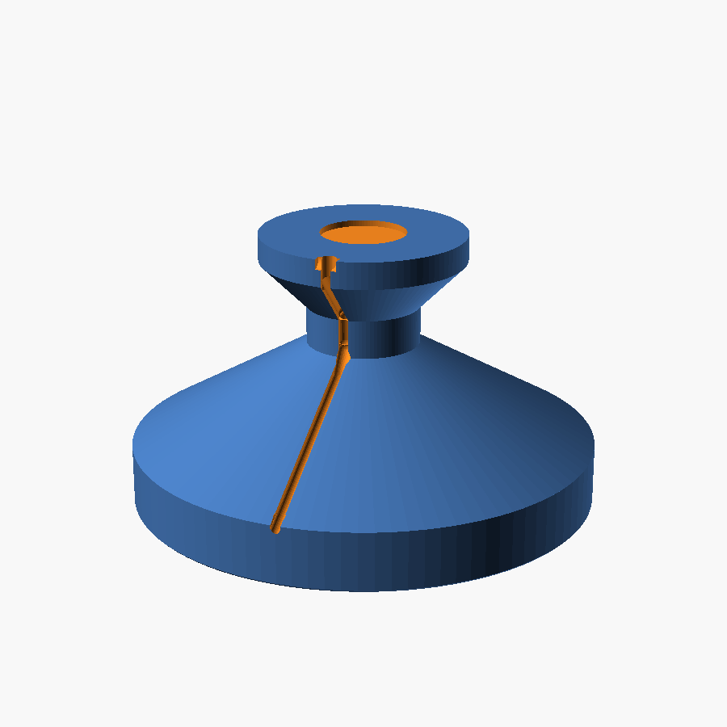
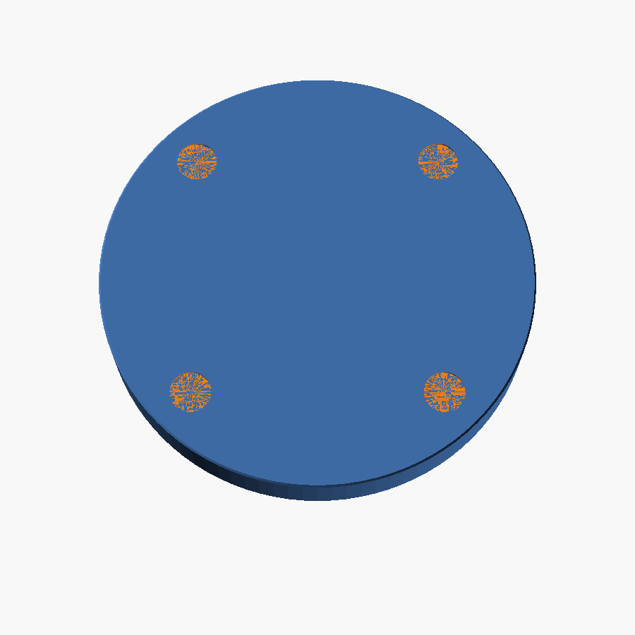
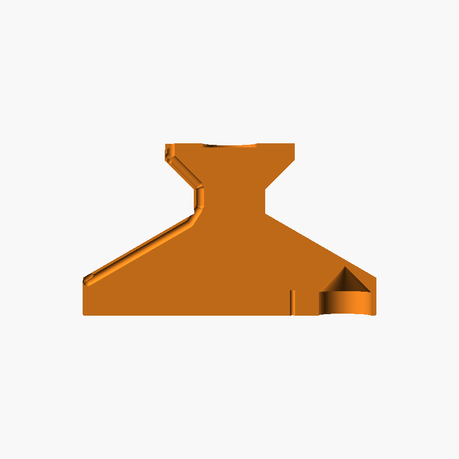
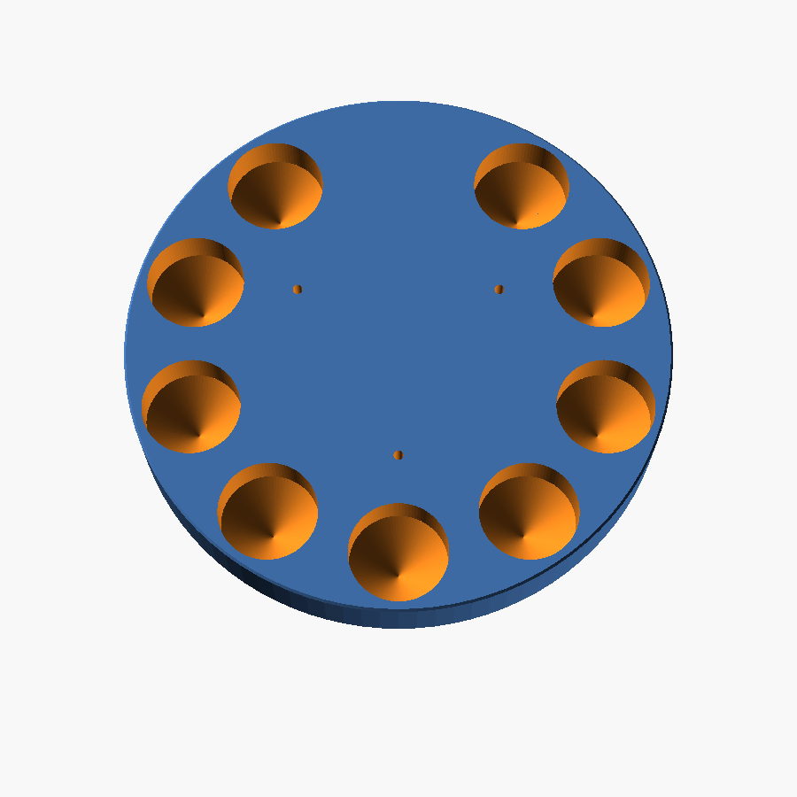

# UniFi Instant Camera Floor Tower

A low, heavy floor stand for a UniFi **G3 Instant** or **G4 Instant**, made as a
puppy cam. It lifts the lens to roughly 15 cm (6 in) and holds the USB cable in
a snap-in channel, so the cable can't twist the camera off its aim.

How it works:

- the camera **keeps its own stand**, which is what tilts it. The stand's foot
  screws onto the flat 62 mm **top pad** with two small screws. The pad is
  8 mm thick so screws bite anywhere. It also has a recess for a 1" steel fender
  washer, in case your stand's foot is magnetic
- a **140 mm wide base** with a low 30° slope. There's nothing tall or thin to
  grab, and it's hard to tip
- **9 ballast wells** underneath, closed by a screwed-on **lid**. Fill them with
  steel BBs, sand, coins or fishing weights
- a **keyhole cable channel** runs from the pad's back edge down the column
  and the base and off the rim. The cable presses in past a narrow throat and
  stays put, and you never have to thread the plug through anything
- pan by turning the whole tower; tilt with the camera's own hinge

## Files

| File | What |
|---|---|
| `stl/tower_G4.stl` | tower for the G4 Instant (pad top at 82 mm) |
| `stl/tower_G3.stl` | tower for the G3 Instant (pad top at 90 mm, it's a shorter camera) |
| `stl/tower_G4_solid.stl` | G4 tower with a solid bottom: no ballast, no lid |
| `stl/tower_G3_solid.stl` | G3 tower with a solid bottom: no ballast, no lid |
| `stl/lid.stl` | ballast lid, same for both (only for the non-solid towers) |
| `instant_camera_tower.scad` | the source; every size is a parameter at the top |

### Solid-bottom version

If you'd rather not deal with ballast and a lid, print a `_solid` tower. Its
underside is flat, with four shallow pockets for stick-on rubber feet. It's
lighter (the print alone, about 150–200 g), so it's easier to push around. Bump
the infill to 30–40% if you want more weight. In the `.scad`, this is
`ballast = false`.

## Measure before printing

I couldn't find published sizes for the stands' feet or the cables, so:

1. **Cable diameter** (`cable_d`, default 4.0 mm). The channel is sized to snap
   over this, so measure each camera's cable with calipers. If one is
   different, set it and re-export.
2. **Lens height.** The heights assume the lens sits about 60–70 mm above the
   bottom of the camera's stand. If you want it higher or lower, change
   `pad_top_g4` / `pad_top_g3`.
3. *(Optional)* For a pocket that the stand's foot drops into, set `foot_d`
   to the foot's diameter. It's off by default so nothing has to match exactly.

## Print settings (PETG or PLA)

- Tower: base down, as exported. **No supports.** The wells have 45° pointed
  roofs and the pad sits on a 45° flare
- 4 walls, 15–20% infill. Add a 100% infill modifier on the top pad if you
  want the camera screws to bite hard
- Lid: flat, as exported. The countersinks face the bed
- Roughly 150–200 g of filament for a tower at those settings

## Assemble

1. Fill the wells with ballast. Steel BBs pack best; pennies stack in them
   too. Keep it below the rim.
2. Screw the lid on with three #4 or M3 self-tapping screws, about 10 mm long.
   Stick rubber bumper feet in the four shallow pockets.
3. Unclip the camera from its stand. Set the stand on the pad with its hinge
   facing forward (away from the channel). Screw it down through its mounting
   holes with small wood or self-tapping screws. If the foot is magnetic,
   press a 1" fender washer into the recess first.
4. Clip the camera back on and plug in the cable. Press it into the channel,
   starting at the notch on the back of the pad and working down to the rim.
5. Aim the tower by turning it, then set the tilt on the camera's hinge.

## If it doesn't fit

- cable won't press in, or is loose: `cable_d`, or `throat_frac` (lower =
  grips harder)
- lens too high or low: `pad_top_g4`, `pad_top_g3`
- still tippy: more ballast, or a wider `base_d`

**Puppy note:** PETG is tougher than PLA if it gets chewed. The cable between
the rim and the outlet is still exposed, so run it behind furniture or through
a cord cover.
